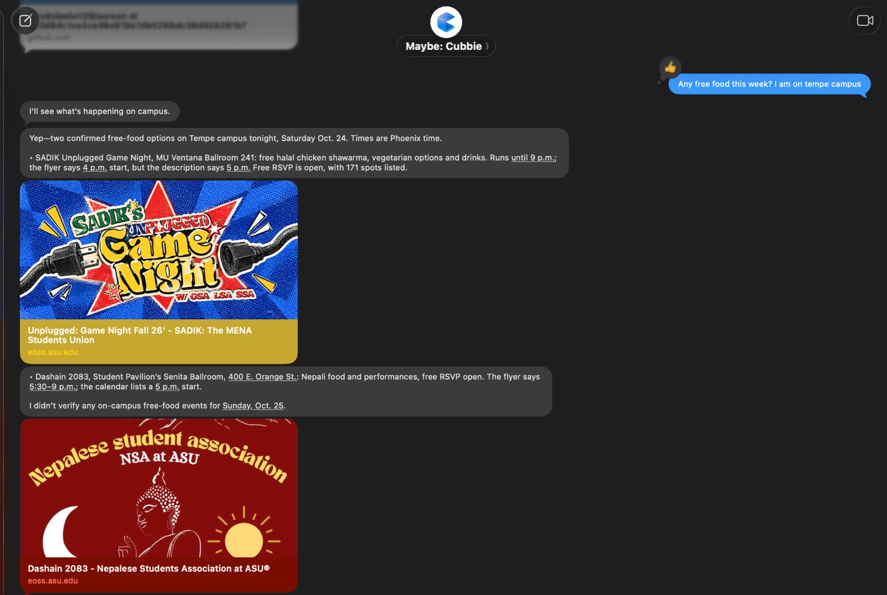
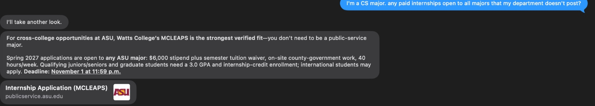
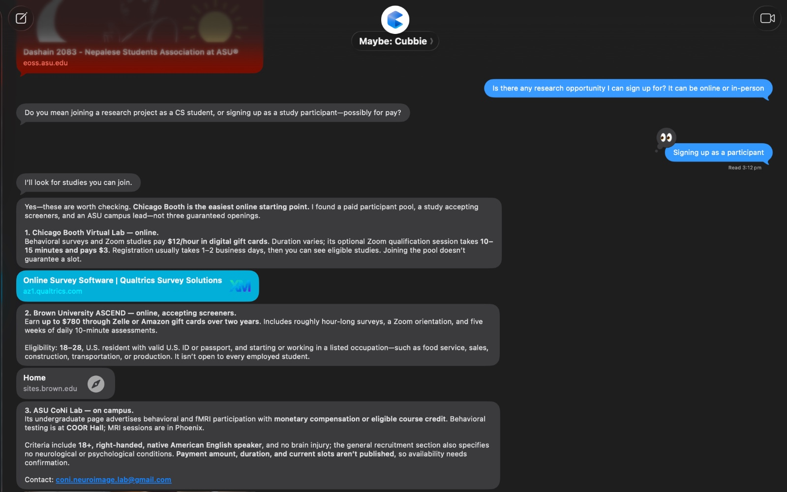

# Freebie Radar

**Free food, paid studies, and the internships your department never told you about, texted to you before they're gone.**

Freebie Radar is a [Cubbie](https://cubbie.ai) Skill for students at Arizona State University. It finds free food,
paid research studies, scholarships and paid opportunities open to every major, keeps only what fits the
student, and texts each one in iMessage with a link to act on it.

Built by **Team Aureon** for Track 1 of the [Cubbie Hackathon](https://hackathon.cubbie.ai).

| | |
| --- | --- |
| **Install** | Text `https://github.com/mrudulaeluri29/aureon/tree/main/freebie-radar` to Cubbie and reply "yes" |
| **Try** | "anything free this week?" |
| **Status** | Installed and tested on a real Cubbie account, October 24, 2026 |

---

## The problem

ASU students are surrounded by things that are free or pay them: club events with food, research studies that
pay in cash or gift cards, scholarships, and paid internships. Students miss most of them, for three reasons.

1. **They are scattered.** Opportunities are spread across SunDevilCentral, club emails, Canvas announcements,
   muted Slack and Discord servers, and dozens of department websites. No student checks all of them.
2. **They expire.** Free food is gone the same evening. Paid studies fill up. Scholarships and internships have
   deadlines that pass before students hear about them.
3. **They are posted in the wrong place.** Many programs are open to every major but listed only by the college
   that runs them. McLEAPS, a paid Maricopa County internship with a stipend and a tuition waiver, is open to
   students "from any major at ASU", yet it is posted by the Watts College of Public Service. A computer science
   or biology student would never look there.

The result is that free and paid opportunities go to whoever happens to see them first, not to the students they
were meant for.

## The solution

Freebie Radar turns Cubbie into a scout that checks these sources for the student and texts only what is worth
acting on, in time to act.

| Category | What it finds | Where it looks |
| --- | --- | --- |
| Free food | Events in the next 48 hours that serve food matching the student's diet | SunDevilCentral, ASU Events, club emails, Canvas, Slack and Discord notification emails |
| Paid studies | Research studies that pay, with pay per hour worked out | The student's email, ASU lab and department pages |
| Scholarships | Open scholarships that match the student's major and year | ASU scholarship pages, trusted national sources |
| Hidden opportunities | Paid internships and programs open to all majors but posted by another college | The websites of 14 ASU colleges |

Every find has to pass one rule: **it is free or pays the student, and the student would likely miss it.**
Freebie Radar is not a general job board or event calendar.

On top of answering questions, it can send a **weekly digest** (Sunday 6 pm by default) that never repeats an
item, **same-day food alerts**, **deadline reminders**, and a ready-to-paste message for **sharing a find with a
friend** it fits better.

## How it works

```text
Student texts Cubbie            "anything free this week?"
        |
        v
1. Profile         Major, year, campus, diet and study preferences, asked once and remembered
        |
        v
2. Collect         SunDevilCentral feed (script)  ·  ASU college and scholarship pages (web)
                   Email and Canvas (the student's connected accounts)
        |
        v
3. Filter          Matches the profile · not expired · not paid entry · not a scam
                   Hidden opportunities: paid + "any major" + posted by another college
        |
        v
4. De-duplicate    scripts/seen.py drops anything already sent and sorts by date
        |
        v
5. Reply           Up to 3 finds per category, short lines, a link for each,
                   and one question about the next step (a reminder, a draft email)
```

**Data sources and how they are reached**

| Source | Access | Notes |
| --- | --- | --- |
| SunDevilCentral | Public calendar feed, read by `scripts/sundevil_food.py` | About 5,000 events. No free-food tag exists, so the script reads titles and descriptions for food and returns each event's link |
| ASU college websites | Public pages, read with Cubbie's web ability | Listed in `references/asu-sources.md` |
| ASU Events | Public pages | Campus-wide events |
| Email and Canvas | The student's own accounts, connected to Cubbie | Club emails, study recruitment, announcements, Slack and Discord notifications |
| Scholarship Universe | ASU sign-in in Cubbie's browser | Optional; offered once, never required |

No API keys, no backend, and no data leaves the student's Cubbie.

## Real tests on Cubbie

All three were run on a real Cubbie account on October 24, 2026.

**Free food.** *"Any free food this week? I am on tempe campus"*
Two SunDevilCentral events with free food, each linked, with a note where the flyer and the calendar disagree on
the start time.



**Hidden opportunity.** *"I'm a CS major. any paid internships open to all majors that my department doesn't post?"*
McLEAPS, posted only by Watts College, open to any ASU major, with its deadline.



**Paid studies.** *"Is there any research opportunity I can sign up for? It can be online or in-person"*
An ASU lab that pays participants, plus online paid study pools, each with pay, time and eligibility. (Taken
before the update that puts ASU studies first and caps the reply at three.)



## Trust and safety

- **The student decides.** Freebie Radar never signs up, applies, claims a spot or sends an email without the
  student's yes.
- **Sources, not guesses.** Every find comes with its link and, for hidden opportunities, the exact sentence that
  shows the student qualifies. When two sources disagree it says so; when a detail is missing it says "not
  listed".
- **Screening stays with the student.** Study screening questions can ask about health or background, so
  Freebie Radar never answers them.
- **Scam filter.** Anything asking for a fee, bank details or a password is dropped.
- **Private by default.** The profile lives in Cubbie's memory. Friends are reached only through a message the
  student chooses to send.

## Using it

After installing, text Cubbie things like:

- "anything free this week?"
- "is there free food tonight? I'm on Tempe campus"
- "any paid studies I can do? online is fine"
- "find me scholarships for CS majors"
- "any paid internships open to all majors?"
- "send me freebies every Sunday"

## Project structure

```text
freebie-radar/
  SKILL.md                      Instructions Cubbie follows, step by step
  references/asu-sources.md     ASU college, scholarship, research and event sources
  scripts/sundevil_food.py      Finds SunDevilCentral events that serve food, with links
  scripts/seen.py               Never sends the same find twice; sorts by date
  assets/sample_sundevil.ics    Sample feed for offline testing
  assets/sample_finds.json      Sample finds for offline testing
screenshots/                    Real tests on Cubbie
```

Both scripts use only the Python standard library (3.9+) and have a `--sample` mode that runs without network
access:

```bash
cd freebie-radar
python3 scripts/sundevil_food.py --sample
python3 scripts/seen.py new --sample
```

The Skill follows the open Agent Skills format, so it also runs in other agents that support that format.

## Known limitations

- Most SunDevilCentral events show their location only after signing in, so Freebie Radar sends the event link
  instead of the room.
- Scholarship Universe, ASU's main scholarship search, requires an ASU sign-in; it is offered as an optional step.
- Discord sends email for only some missed messages, so a few Discord posts can slip through.
- College websites are sometimes out of date. Items without a current date or deadline are dropped.

## What's next

**Freebie Network (Track 2):** every student gets an agent, and agents pass finds to each other. A scholarship
one student can't use reaches the student who can; a study with 10 spots is shared fairly among the 25 students
who qualify. Agents share only "match" or "no match", never a student's major, schedule or background, and a
student's name leaves only after they say yes.

---

**Team Aureon** · Cubbie Hackathon 2026 · Track 1: Cubbie Skills

If Freebie Radar would help you, vote for it at **[hackathon.cubbie.ai](https://hackathon.cubbie.ai)** (school email required).
